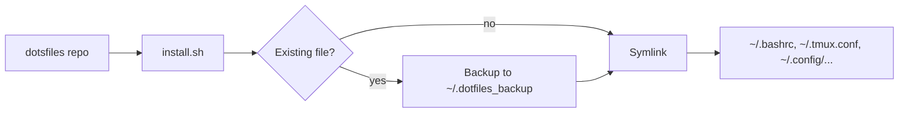

<div align="center">

# dotfiles

**Portable bash-core dotfiles for Linux, macOS and WSL.**

 

[](https://github.com/adineo-cmd/dotfiles/stargazers) [](https://github.com/adineo-cmd/dotfiles/commits)

[Quick start](#quick-start) · [How it works](#how-it-works) · [Features](#features)

</div>

---

A small, dependency-free dotfiles set: bash, git, tmux, starship, Neovim and VS
Code. The installer links files, backs up whatever it replaces, and runs on
Linux, macOS and WSL without a package manager.

**Twenty tracked files.** No framework, no plugin manager, no runtime.

## Features

| | Feature | What it does |
| --- | --- | --- |
| 🧳 | **Zero-dependency install** | `install.sh` uses bash and `ln`; nothing else is required. |
| 🧯 | **Safe by default** | `--dry-run` previews, every replaced file is moved to a timestamped backup. |
| 🐚 | **Bash core** | Aliases, profile, rc, inputrc and one shared file sourced by both interactive shells. |
| ✂️ | **Small tools** | `git-clean-branches`, a Starship prompt and a VS Code settings and extension list. |

## How it works

The installer is intentionally boring:

1. Resolve the repository root.
2. For each tracked file, move any existing target into
   `~/.dotfiles_backup/<timestamp>/`.
3. Symlink the tracked file into place.
4. `--uninstall` reverses the links; `--force` overwrites without asking.



## Quick start

bash and `ln`. Neovim, tmux, Starship and VS Code are optional — the installer skips what is absent.

**Preview**

```bash
git clone https://github.com/adineo-cmd/dotfiles.git ~/dotfiles
cd ~/dotfiles
./install.sh --dry-run
```

**Install**

```bash
./install.sh
# replaces are backed up to ~/.dotfiles_backup/<timestamp>/
```

**Restore VS Code**

```bash
grep -v '^#' vscode/extensions.txt | grep -v '^$' | xargs -L1 code --install-extension
```

## Project structure

```text
install.sh         link, backup and uninstall
bash/              .bashrc, .bash_profile, aliases, inputrc, shell_common
git/               .gitconfig, global ignore, local identity example
tmux/              .tmux.conf
starship/          starship.toml
nvim/              init.lua
vscode/            settings, extensions, notes
bin/               git-clean-branches
docs/              fresh-machine setup per OS
```

## Secrets rule

Never commit `*.local`, tokens, `.ssh/`, `.gnupg/` or `.env`. Machine-specific
values go in `*.example` templates that are copied and filled in locally:

```bash
cp git/gitconfig.local.example git/gitconfig.local
```

`docs/SETUP.md` has the per-OS fresh-machine steps.

## License

MIT © 2026 adineo-cmd. See [LICENSE](LICENSE).
